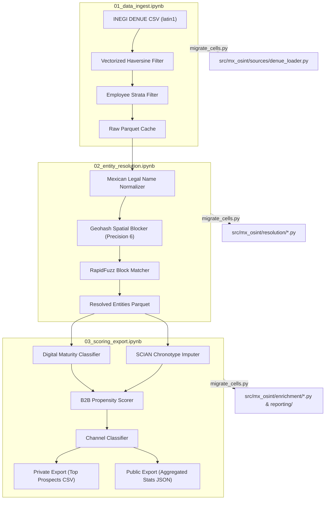

# mexico-commercial-osint

Commercial OSINT, Geospatial Entity Resolution, and B2B Lead Scoring toolkit engineered specifically for Mexican economic datasets (INEGI DENUE, SCIAN Mexico taxonomy, and Mexican legal entity suffixes).

Optimized for **CPU-only execution** using **Polars**, **RapidFuzz**, and **DuckDB**, without heavyweight PyTorch/CUDA dependencies.



## Why Mexico-Specific?

1. **INEGI DENUE Nuances:** Ingests official directory data distributed with latin1-compatible encoding, specific column headers (`clee`, `per_ocu`, `codigo_act`), and custom employee strata.
2. **Mexican Legal Entity Suffixes:** Accurate normalization for legal corporate forms (`S.A.P.I. DE C.V.`, `S.A. DE C.V.`, `S. DE R.L. DE C.V.`, `S.C.`, `A.C.`, `S.A.B. DE C.V.`).
3. **SCIAN Mexico Taxonomy:** Business activity classification mapped directly to operating chronotypes (e.g., 6 AM early morning shifts vs standard office vs continuous 24/7 operations) and B2B demand weights.
4. **License Compliance:** Strict horizontal separation between Libre Uso MX (INEGI DENUE) and OpenStreetMap ODbL.

## Quickstart

```bash
git clone https://github.com/emmanuel-ortiz/mexico-commercial-osint.git
cd mexico-commercial-osint

# Setup environment
cp .env.example .env
make install

# Run pipeline validation notebooks
make ingest
make resolve
make score
```

## Notebook -> Module Migration Path

Notebooks in `notebooks/` serve as isolated validation environments. Every cell definition carries a `# MIGRATES TO: src/mx_osint/<module>.py::<function>` comment.

| Notebook | Function / Target | Target Module |
|---|---|---|
| `01_data_ingest` | `Settings` | `src/mx_osint/config.py` |
| `01_data_ingest` | `download_denue_state` | `src/mx_osint/sources/denue_loader.py` |
| `01_data_ingest` | `read_denue_csv` | `src/mx_osint/sources/denue_loader.py` |
| `01_data_ingest` | `filter_by_radius` | `src/mx_osint/sources/denue_loader.py` |
| `01_data_ingest` | `filter_by_strata` | `src/mx_osint/sources/denue_loader.py` |
| `02_entity_resolution` | `normalize_mexican_legal_name` | `src/mx_osint/resolution/mex_name_normalizer.py` |
| `02_entity_resolution` | `assign_geohash_block` | `src/mx_osint/resolution/spatial_blocker.py` |
| `02_entity_resolution` | `match_within_blocks` | `src/mx_osint/resolution/fuzzy_matcher.py` |
| `02_entity_resolution` | `assign_entity_ids` | `src/mx_osint/resolution/entity_resolver.py` |
| `03_scoring_export` | `impute_chronotype` | `src/mx_osint/enrichment/chronotype_imputer.py` |
| `03_scoring_export` | `classify_digital_maturity` | `src/mx_osint/enrichment/digital_maturity.py` |
| `03_scoring_export` | `score_b2b_propensity` | `src/mx_osint/enrichment/b2b_propensity.py` |
| `03_scoring_export` | `classify_channel` | `src/mx_osint/activation/channel_classifier.py` |
| `03_scoring_export` | `discover_channel_ddg` | `src/mx_osint/activation/channel_classifier.py` |
| `03_scoring_export` | `export_dual` | `src/mx_osint/reporting/prospect_report.py` |

Migrate functions to modules using:
```bash
make migrate-cells
```

## Use Cases

- **B2B Commercial Prospecting:** Identify dense clusters of high-headcount employers within target catchment radiuses.
- **Urban Chronotype Analysis:** Discover morning vs evening commercial activity by SCIAN sectors.
- **Municipal Digital Maturity Index:** Measure corporate domain adoption across economic activities.

## License Compliance

See [docs/LICENSE_COMPLIANCE.md](docs/LICENSE_COMPLIANCE.md) for details on INEGI Libre Uso MX terms and OpenStreetMap ODbL isolation.

## Security & Clean-Room Policy

See [SECURITY.md](SECURITY.md). All commits are audited by `scripts/check_blacklist.sh`.
