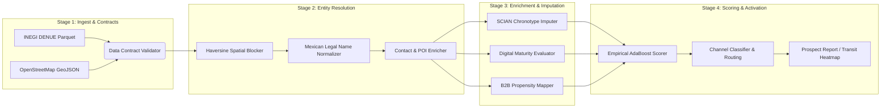

# 🇲🇽 mexico-commercial-osint (`mx_osint`)

[](.github/workflows/ci.yml)
[](pyproject.toml)
[](LICENSE)
[](pyproject.toml)

**`mexico-commercial-osint`** is a production-grade Open-Source Intelligence (OSINT) entity resolution, enrichment, and B2B propensity scoring engine tailored for the Mexican commercial ecosystem. 

By fusing official national statistical registries (**INEGI DENUE** & **SCIAN** North American Industry Classification codes) with crowd-sourced geospatial telemetry (**OpenStreetMap**), `mx_osint` transforms noisy, fragmented public directories into high-confidence, compliance-first commercial graphs.

---

## 🧠 Why OSINT? And Why Does It Matter for Mexican B2B Data?

### What is Commercial OSINT?
**Open-Source Intelligence (OSINT)** is the discipline of collecting, correlating, and analyzing publicly available data sources to produce actionable intelligence. Unlike grey-hat web scraping or purchasing opaque third-party broker lists, engineering-driven OSINT relies strictly on **authoritative, legally open datasets** (open government data, public cartography, and statutory registries) governed by strict data contracts and provenance tracking.

### Why Follow an OSINT Architecture in Mexico?
Engineers building B2B growth, credit underwriting, logistics, or retail expansion pipelines in Mexico immediately hit three structural walls:
1. **High Commercial Informality & Churn:** A massive percentage of Mexican SMBs (*PyMEs*) operate without corporate websites or LinkedIn footprints, making US-centric enrichment APIs (Clearbit, ZoomInfo, Apollo) blind to local reality.
2. **Noisy & Disjointed Public Registries:** INEGI’s **DENUE** (*Directorio Estadístico Nacional de Unidades Económicas*) tracks over 5 million active businesses with granular **SCIAN** codes and employee headcount brackets, but often lacks modern digital contact channels or operating hours. Conversely, **OpenStreetMap (OSM)** captures ground-truth POIs, transit nodes, and opening hours, but lacks legal corporate taxonomy.
3. **Strict Regulatory Boundaries (LFPDPPP):** Mexico’s *Ley Federal de Protección de Datos Personales en Posesión de los Particulares* imposes heavy penalties for processing non-consensual personal PII. 

**Our Solution:** `mx_osint` bridges this gap legally and deterministically. By resolving entities across DENUE and OSM using spatial blocking and Mexican-specific phonetic/lexical normalization, we impute operational chronotypes, digital maturity, and B2B readiness **using 100% open data and zero private PII**.

---

## 🏗️ System Architecture & Pipeline Stages



### Core Engineering Modules (`src/mx_osint/`)

| Submodule | Key Components | Engineering Problem Solved |
| --- | --- | --- |
| **`sources/`** | `denue_loader.py`, `osm_loader.py` | Standardized ingestion of INEGI DENUE snapshots and OSM spatial geometries into typed schemas. |
| **`resolution/`** | `spatial_blocker.py`, `mex_name_normalizer.py`, `contact_enricher.py` | Avoids $O(N^2)$ pairwise comparisons via Haversine spatial blocking; strips Mexican corporate suffixes (*S.A. de C.V.*, *S. de R.L.*) and honorifics before fuzzy matching. |
| **`enrichment/`** | `chronotype_imputer.py`, `digital_maturity.py`, `b2b_propensity.py` | Maps 6-digit SCIAN codes (`data_contracts/scian_*.json`) to operational time windows (morning/diurnal/nocturnal) and digital footprint tiers. |
| **`scoring/`** | `b2b_qualifier.py`, `empirical_adaboost_scorer.py` | Combines employee strata, SCIAN propensity, and digital maturity into a calibrated B2B conversion score. |
| **`activation/`** | `channel_classifier.py`, `contracts.py` | Routes qualified entities to optimal outreach channels (WhatsApp Business, Field Sales, Email, Cold Call) based on digital signals. |
| **`viz/`** | `explorer.py`, `transit_heatmap.py` | Generates geospatial prospect density maps and commercial transit heatmaps. |

---

## 🚀 Quickstart (Zero External Data Required)

This repository includes synthetic, privacy-safe fixtures (`fixtures/synthetic_denue_sample.parquet` and `fixtures/synthetic_osm_sample.geojson`) so you can run the entire resolution and scoring pipeline locally in seconds.

### 1. Installation

```bash
git clone https://github.com/your-org/mexico-commercial-osint.git
cd mexico-commercial-osint

# Create virtual environment and install dependencies
python3 -m venv .venv
source .venv/bin/activate
pip install -e ".[dev]"
```

### 2. Run Verification & Compliance Suite

```bash
# Run unit tests (Haversine math, Mexican name normalization, SCIAN mappings, routing)
pytest

# Verify zero blacklisted PII or private keys exist in the workspace
bash scripts/check_blacklist.sh
```

### 3. Run End-to-End Synthetic Pipeline

See the [`examples/`](examples/) directory for standalone scripts, or launch the interactive demo:

```bash
# Execute standalone quickstart pipeline
make demo

# Or explore via interactive Jupyter Lab notebooks
jupyter lab notebooks/
```

---

## 💻 Usage Examples

### Example 1: Mexican Corporate Name Normalization & Spatial Resolution

Standard NLP normalizers fail on Mexican business registries due to legal suffixes (`S.A.P.I. de C.V.`), regional abbreviations (`Hnos.`, `Gpo.`), and diacritics.

```python
from mx_osint.resolution.mex_name_normalizer import normalize_mexican_business_name
from mx_osint.resolution.spatial_blocker import SpatialBlocker

raw_denue = "DISTRIBUIDORA DE INSUMOS DEL BAJÍO, S.A. DE C.V."
raw_osm = "Distribuidora de Insumos del Bajio"

norm_denue = normalize_mexican_business_name(raw_denue)
norm_osm = normalize_mexican_business_name(raw_osm)
assert norm_denue == norm_osm  # -> "distribuidora insumos bajio"
```

### Example 2: SCIAN Chronotype & B2B Propensity Enrichment

When opening hours are missing from public records, `mx_osint` uses deterministic SCIAN priors (`data_contracts/scian_chronotype_mapping.json`) to infer when a business operates and whether it is a viable B2B counterparty.

```python
from mx_osint.enrichment.chronotype_imputer import ChronotypeImputer
from mx_osint.enrichment.b2b_propensity import B2BPropensityEnricher

imputer = ChronotypeImputer()
enricher = B2BPropensityEnricher()

# SCIAN 311811: Panificación industrial vs. 722412: Bares y cantinas
profile = imputer.impute(scian_code="311811")
propensity = enricher.evaluate(scian_code="311811", estrato_personal="31 a 50 personas")
```

---

## 🛡️ Ethics, Privacy & License Compliance

OSINT requires rigorous self-governance. This project enforces strict guardrails:

* **No Personal PII:** We strictly process *Unidades Económicas* (commercial legal entities), never private individuals. See [`docs/ETHICS.md`](docs/ETHICS.md).
* **Automated Blacklist Gates:** Pre-commit hooks (`.githooks/pre-commit`) and [`scripts/check_blacklist.sh`](scripts/check_blacklist.sh) block raw data dumps (`data/private/`, `data/raw/`) from ever entering version control.
* **Open Data Attribution:** Compliant with INEGI’s *Libre Uso MX* terms and OpenStreetMap’s ODbL license. See [`docs/LICENSE_COMPLIANCE.md`](docs/LICENSE_COMPLIANCE.md).
* **Deterministic Schema Contracts:** Enforces strict Pydantic schemas across pipeline transitions. See [`data_contracts/schema_golden_set.py`](data_contracts/schema_golden_set.py).
* **Mathematical & Algorithmic Foundations:** See [`docs/OSINT_METHODOLOGY.md`](docs/OSINT_METHODOLOGY.md).
