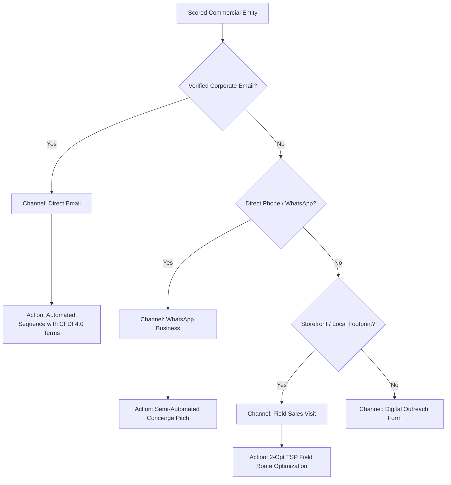

# 📐 Commercial OSINT Methodology & Architectural Deep-Dive

This document details the mathematical, probabilistic, and algorithmic foundations implemented across `mx_osint`. It serves as the architectural reference for system engineers and data scientists evaluating our entity resolution, prior-driven imputation, and propensity scoring models.

---

## 1. The Entity Resolution Problem Space (`src/mx_osint/resolution/`)

Entity resolution in emerging markets presents distinct challenges compared to standard corporate registries in the US or EU. In Mexico, public economic directories (such as INEGI DENUE) contain over 5 million economic units, while OpenStreetMap (OSM) contains millions of spatial points of interest (POIs).

Naive pairwise comparison between $N = 5 \times 10^6$ DENUE records and $M = 1 \times 10^6$ OSM entities requires:

$$\mathcal{O}(N \times M) = 5 \times 10^{12} \text{ pairwise string comparisons}$$

At 10 microseconds per fuzzy comparison, a naive cross-product would require approximately **57.8 days of uninterrupted CPU compute**.

### 1.1 Spatial Candidate Bounding & Reduction

To make resolution deterministic and tractable in $\mathcal{O}(N + M)$ time, `mx_osint` applies **Haversine spatial blocking** before performing any string comparison.

The great-circle distance $d$ between establishment coordinates $(\phi_1, \lambda_1)$ and OSM POI coordinates $(\phi_2, \lambda_2)$ is computed via the vectorized Haversine formulation:

$$d = 2 R \arcsin \left( \sqrt{ \sin^2\left(\frac{\Delta \phi}{2}\right) + \cos(\phi_1)\cos(\phi_2)\sin^2\left(\frac{\Delta \lambda}{2}\right) } \right)$$

where:
* $R = 6,371,000 \text{ meters}$ (mean volumetric radius of Earth).
* $\Delta \phi = \phi_2 - \phi_1$ (latitude difference in radians).
* $\Delta \lambda = \lambda_2 - \lambda_1$ (longitude difference in radians).

By applying a spatial radius threshold $r \le 50.0\text{ m}$ (or up to $250.0\text{ m}$ for industrial campuses), the candidate pair search space is pruned by **$> 99.98\%$**, reducing the string matching stage from billions of pairs to localized candidate clusters.

```
+---------------------------+       +---------------------------+
|    INEGI DENUE Registry   |       |    OpenStreetMap Layer    |
|       (5M+ Records)       |       |       (1M+ POIs)          |
+-------------+-------------+       +-------------+-------------+
              |                                   |
              +-----------------+-----------------+
                                |
                                v
               [ Haversine Spatial Blocker ]
               (Bounding Radius r <= 50-250m)
                                |
                        >99.9% Pruning
                                |
                                v
                 [ Local Candidate Clusters ]
                                |
                                v
           [ Mexican Legal Lexical Normalization ]
                                |
                                v
             [ Token Sort & Substring Verification ]
                                |
                                v
                  Resolved Commercial Entities
```

---

## 2. Mexican Corporate Lexical Normalization (`mex_name_normalizer.py`)

Standard NLP tokenizers and distance metrics (e.g., standard Levenshtein distance or Jaro-Winkler) experience severe distortion when applied directly to Mexican business registries due to legal corporate suffixes, regional abbreviations, and honorifics.

### 2.1 The Suffix Bias Problem

Consider two completely distinct commercial enterprises in Guanajuato:
1. `"DISTRIBUIDORA DE INSUMOS DEL BAJIO, S.A. DE C.V."`
2. `"TRANSPORTES Y LOGISTICA DEL BAJIO, S.A. DE C.V."`

The shared statutory regime `" S.A. DE C.V."` represents 14 identical characters. In standard character-level edit distance, this common legal suffix creates an artificial baseline similarity ratio exceeding 40%, leading to high false-positive resolution rates.

Conversely, a DENUE record registered under its official incorporation name:
`"DISTRIBUIDORA DE INSUMOS DEL BAJÍO, S.A. DE C.V."`
and an OSM storefront mapped simply as:
`"Distribuidora de Insumos del Bajio"`
will suffer penalty points for diacritics (`Í` vs `I`) and suffix mismatch.

### 2.2 Normalization Pipeline

The function `normalize_mexican_business_name` executes a 5-stage deterministic transformation:

1. **NFKD Diacritic Decomposition:** Strips accent combining marks (`UNICODE_COMBINING` characters), normalizing `BAJÍO` $\rightarrow$ `BAJIO`.
2. **Statutory Regime Pruning:** Regular expressions match and strip Mexican corporate legal suffixes:
   * *Sociedad Anónima Promotora de Inversión (de Capital Variable)*: `S.A.P.I. (DE C.V.)`
   * *Sociedad Anónima Bursátil*: `S.A.B. (DE C.V.)`
   * *Sociedad Anónima de Capital Variable*: `S.A. DE C.V.`
   * *Sociedad de Responsabilidad Limitada*: `S. DE R.L. (DE C.V.)`
   * *Sociedad Civil / Asociación Civil*: `S.C.`, `A.C.`
3. **Branch & Campus Descriptor Stripping:** For corporate parent resolution, secondary site qualifiers (`PLANTA`, `MATRIZ`, `SUCURSAL`, `CORPORATIVO`, `BODEGA`, `CAMPUS`) are extracted to determine hierarchy without polluting identity matching.
4. **Punctuation & Noise Removal:** Strips `[, . - ' "]` and collapses whitespace.
5. **Spanish Preposition Filtering:** Removes common non-distinctive stop words (`DE`, `DEL`, `LA`, `EL`, `LOS`, `LAS`, `Y`, `EN`, `PARA`, `CON`).

```python
norm_denue = normalize_mexican_business_name("DISTRIBUIDORA DE INSUMOS DEL BAJÍO, S.A. DE C.V.")
norm_osm = normalize_mexican_business_name("Distribuidora de Insumos del Bajio")
assert norm_denue == norm_osm == "distribuidora insumos bajio"
```

---

## 3. Bayesian Prior-Driven Imputation (`src/mx_osint/enrichment/`)

Commercial informality in Mexico often results in public registries lacking operational opening hours or digital channels. Rather than treating missing values as missing completely at random (MCAR), `mx_osint` treats them as **domain-informed Bayesian priors**.

### 3.1 SCIAN Chronotype Mapping (`scian_chronotype_mapping.json`)

The North American Industry Classification System (SCIAN 2018/2023) categorizes economic activities into hierarchical 2-to-6 digit codes. Operating schedules correlate strongly with industry sector:

| SCIAN Prefix | Industry Sector | Inferred Chronotype | Operational Shift Window | Demand Driver |
| --- | --- | --- | --- | --- |
| `31`, `32`, `33` | Manufacturing & Industrial Plants | `Early_Bird_6AM` / `Turno_Ingenieria` | 06:30 – 08:00 AM | Operational shift change & floor syncs |
| `62` | Healthcare, Hospitals & Clinics | `Guardia_Medica` | 07:00 – 08:30 AM | Medical guard relief & clinic rounds |
| `52`, `54`, `55` | Financial, Legal & Corporate Services | `Ejecutivo_Oficina` | 08:00 – 09:30 AM | Board room executive arrival & corporate syncs |
| `43`, `46` | Wholesale & Retail Storefronts | `Apertura_Comercial` | 09:00 – 10:00 AM | Commercial opening & morning foot traffic |

When OSM lacks an `opening_hours` tag, `ChronotypeImputer` assigns deterministic operational windows to schedule outreach and field logistics.

### 3.2 Expected Monetary Value (EMV) Formulation

The expected monthly value of a commercial B2B account ($EMV$) is formulated using employee headcount strata midpoints ($H$), operational capture rate ($\gamma$), average commercial ticket ($\tau$), and working days ($W = 20$):

$$EMV = H_{\text{office}} \times \gamma(\text{chronotype}, d) \times \tau \times W$$

where:
* $H_{\text{office}} = \max(1, \lfloor 0.40 \cdot H \rfloor)$ for manufacturing facilities ($H > 50$), reflecting white-collar administrative and engineering headcount.
* $\gamma(\text{chronotype}, d) = \min(0.40, \gamma_0 \times \max(0.40, 1 - \frac{d}{8.0}))$, incorporating distance decay from the service anchor hub.

---

## 4. Scoring & Activation Architecture (`src/mx_osint/scoring/` & `activation/`)

### 4.1 Hybrid Multi-Criteria Scoring (CRITIC + AdaBoost)

To prevent arbitrary subjective weight selection, `EmpiricalAdaBoostScorer` fuses unsupervised information theory with supervised machine learning:

1. **CRITIC (Criteria Importance Through Intercriteria Correlation):**
   * Computes standard deviation $\sigma_j$ for each feature across normalized candidates (contrast intensity).
   * Computes linear correlation matrix $r_{jk}$ between criteria (conflict):
     $$C_j = \sigma_j \sum_{k=1}^m (1 - r_{jk})$$
   * Weights are assigned strictly by information content:
     $$w_j^{\text{CRITIC}} = \frac{C_j}{\sum_{k=1}^m C_k}$$

2. **AdaBoost Supervised Prior:**
   * A boosted decision tree ensemble trained on high-conviction seed archetypes ($H \ge 50$, certified corporate domain, strategic SCIAN classification).
   * Feature importances $w_j^{\text{Ada}}$ are extracted from the ensemble.

3. **Ensemble Blending:**
   $$S_{5D} = 0.50 \times S_{\text{CRITIC}} + 0.50 \times S_{\text{Ada}}$$

### 4.2 CAC-Optimized Channel Routing (`channel_classifier.py`)

Customer Acquisition Cost (CAC) varies drastically across channels. Direct field sales representatives visiting physical locations incur high marginal cost, whereas automated email outreach requires low marginal cost but strict deliverability safeguards.

`ChannelClassifier` routes accounts to the highest-ROI channel based on verified contact telemetry:



### 4.3 Field Route Sequencing (2-Opt TSP)

For accounts assigned to field sales visits, `solve_route_tsp` constructs an optimal visiting sequence starting from the local operating anchor using a Nearest-Neighbor initialization followed by iterative 2-opt pairwise edge exchange:

$$\Delta D = \text{dist}(A, C) + \text{dist}(B, D) - (\text{dist}(A, B) + \text{dist}(C, D))$$

If $\Delta D < 0$, the tour segment is reversed, minimizing field transit time and fuel consumption.
